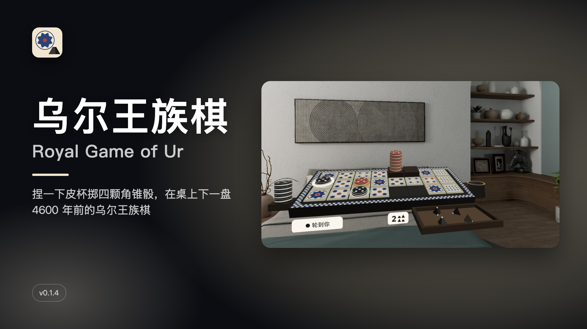
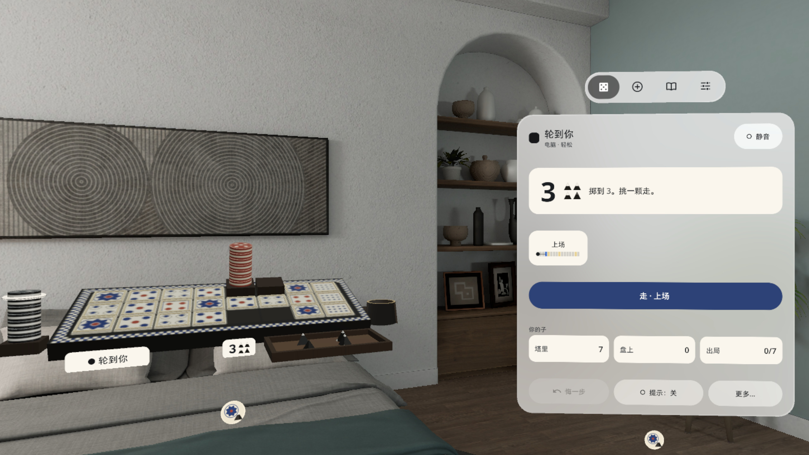
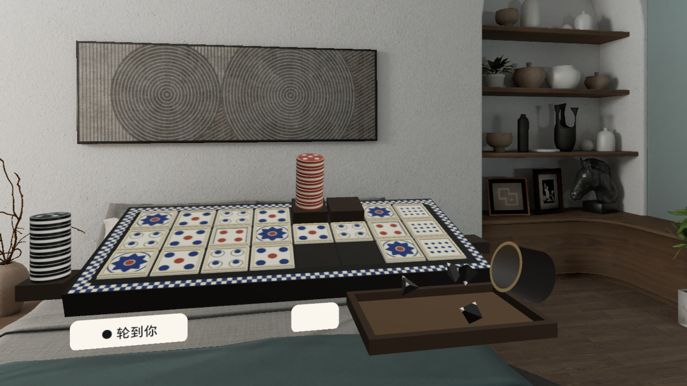
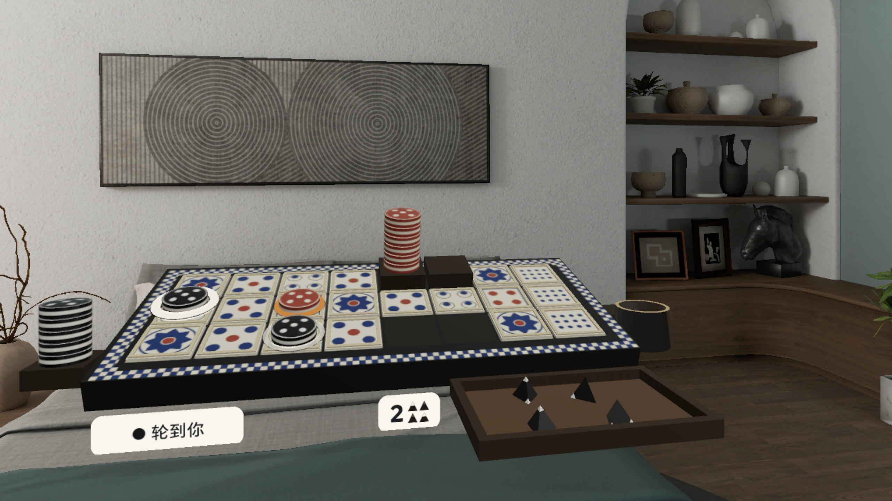
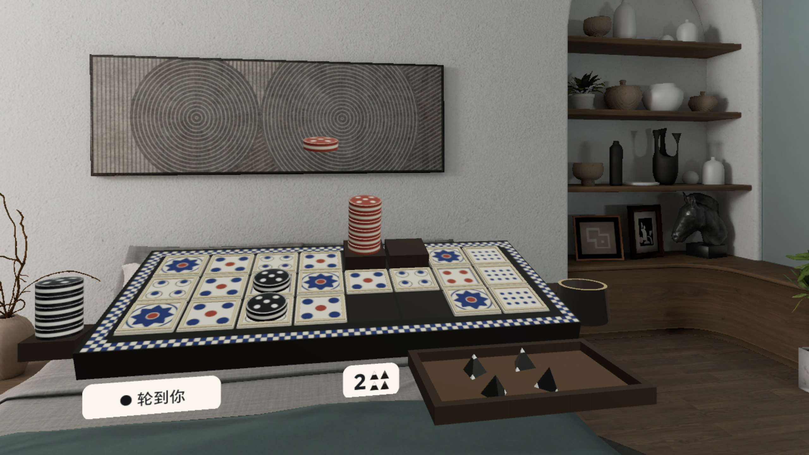
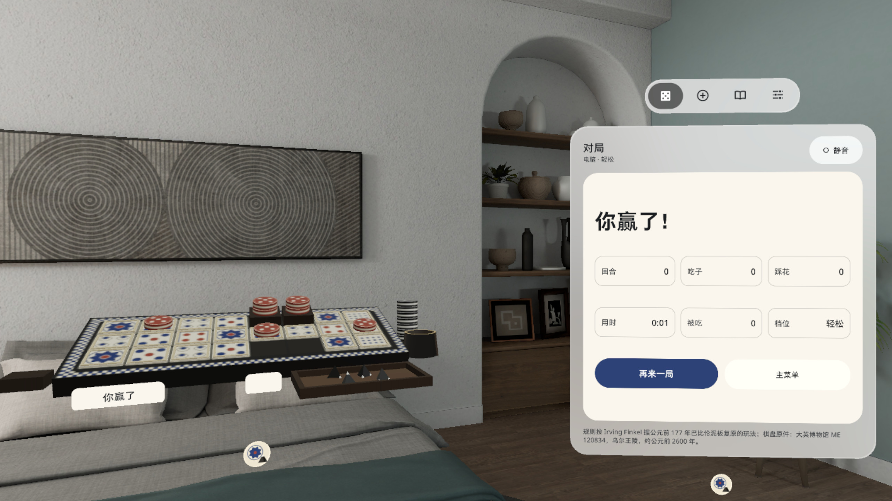
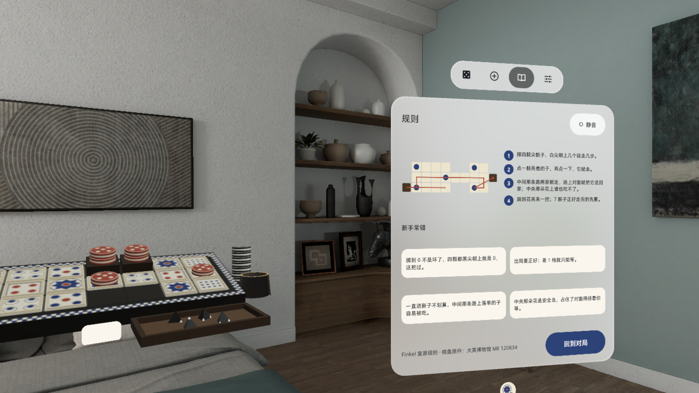

# 乌尔王族棋 Royal Game of Ur



[中文](#中文) · [English](#english)

---

## 中文

**捏一下皮杯掷四颗角锥骰，在桌上下一盘 4600 年前的乌尔王族棋。**

PICO 空间应用（PICO OS 6 · Spatial SDK 6.1.9 · Shared Space 立体窗口 + 控制窗）。一块乌尔王族棋盘摆在你面前：捏一下皮杯，四颗角锥骰倒进骰盘滚停，挑一颗亮着的子让它走；中间那条路两家共用，追上就把对方吃回家，踩到玫瑰花再掷一次，7 颗子先走完的赢。

### 能做什么

- **真骰子**：四颗角锥骰从皮杯里倒出来，物理滚停，白尖朝上的数就是步数（0–4）
- **两种走法**：点棋盘上亮着的子，或者在控制窗里挑那颗子再按 [走]；吃子、踩花、出局都先预览再确认
- **吃子 / 玫瑰花**：被吃的子沿弧线飞回起点塔；踩到玫瑰花再掷一次，花格上的子不能被吃
- **对手**：电脑（轻松 / 聪明）或两人同玩；悔一步 / 重做、提示开关
- **规则页**：Irving Finkel 复原规则，一图看懂路线；新手常错的几条单独列出
- 手柄射线、手势射线、眼手（注视 + 捏合）都能点；静音开关在主页面；设置里可直接退出应用（二次确认）；中英双语；本机运行，不联网、不要账号

### 截图

> v0.1.4 截图和演示视频来自 PICO 模拟器 6.1（中文界面），由调试广播驱动，**非真实手势录像**。演示视频 `video-01.mp4`（52 s，无声）在 Release 资产里。

| | |
|---|---|
|  掷到 3：棋盘和控制窗同框，控制窗里挑子再按 [走] |  掷骰：皮杯倾倒，四颗角锥骰落进骰盘 |
|  吃子预览：橙色环标出要吃的对方子 |  吃子：被吃的红子沿弧线飞回起点塔 |
|  7 颗子走完：结果卡显示回合、吃子、踩花、用时 |  规则页：路线图 + 新手常错 |

### 安装

[Release v0.1.4](https://github.com/kejing-dev/RoyalGameOfUr/releases/tag/v0.1.4) 里的 `RoyalGameOfUr-v0.1.4.apk` 是未签名的 release 包（给应用商店上架用，平台重签名，不能直接 `adb install`）。自己装请从源码构建 debug 包，头显开启开发者模式并用 USB 连上电脑：

```bash
./gradlew assembleDebug
adb install -r app/build/outputs/apk/debug/app-debug.apk
pico-cli app launch io.embodit.royalur
```

需要 PICO OS 6（Android 15，minSdk 35）。不申请任何权限。

### 已知问题

1. v0.1.2 模拟器 QA 第 3 轮已过；v0.1.3–v0.1.4 是真机反馈修复（选子音统一柔和、皮杯下移不挡终点塔、格边框 / 棋子 / 塔承载系统高亮），由用户在头显上看过放行，没有再跑完整一轮模拟器 QA。
2. 模拟器里平视时，空着的终点塔底座会被皮杯挡住一部分（塔仍可点）。
3. 从右侧 30° 看，系统摆的控制窗会压住皮杯一角。
4. 长时间挂机（soak）看门狗没做。
5. 手柄输入在真机上还没查实（手势射线和眼手已在头显上用过）。

### 版本历史

- **v0.1.4**（真机反馈）：皮杯下移、靠在棋盘边，不再挡终点塔；格边框、棋子、塔都能承载系统注视高亮，眼手看得到落点
- **v0.1.3**（真机反馈）：选子 / 换选 / 取消统一成一个柔和短音，同一事件只响一次，整体留出余量不爆音；TabBar 文字跟随应用语言
- **v0.1.2**：控制窗各页撑满窗口，空白 ≤ 13%（QA 第 2 轮打回项）
- **v0.1.1**：两侧起点 / 终点塔和皮杯挪开不挡格子，高亮环分层看得清，控制窗里可以直接选子；实物声换成 CC0 录音
- **v0.1.0**：首个版本，Finkel 规则、角锥骰、两档电脑

### 许可与素材

- 规则：Irving Finkel 复原规则；棋盘纹样参考大英博物馆藏品 ME 120834
- 实物音效：Kenney（CC0）录音；UI 提示音由 `tools/make_sounds.py` 合成
- 字体：Noto Sans（SIL Open Font License，见 `third_party/`）
- 本仓库公开；用 Claude Code 在「黑灯工厂」产线上研发（Claude Opus 5.5 研发 / QA / 发布，Claude Fable 5.1 调研 / 设计）
- 开发结构、调试广播见 [AGENTS.md](AGENTS.md)

---

## English

**Pinch the leather cup, pour four pyramid dice, and play the 4,600-year-old Royal Game of Ur on your table.**

A PICO spatial app (PICO OS 6 · Spatial SDK 6.1.9 · Shared Space volume + control window). A Royal Game of Ur board sits in front of you: pinch the cup, four tetrahedral dice tumble into the tray, then pick a lit piece and move it. The middle lane is shared, so landing on a rival sends it home; a rosette gives you another throw; first to bear off all 7 pieces wins.

### Features

- **Real dice**: four pyramid dice pour out of the cup and settle with physics; white tips up = steps (0–4)
- **Two ways to move**: tap a lit piece on the board, or pick it in the control window and press [Move]; captures, rosettes and bearing off are previewed first
- **Captures and rosettes**: a captured piece arcs back to its start tower; a rosette gives another throw and protects the piece on it
- **Opponents**: computer (easy / smart) or two players; undo / redo; hint toggle
- **Rules page**: Irving Finkel's reconstruction with a route diagram and common beginner mistakes
- Works with controller ray, hand ray and eye-hand (gaze + pinch); mute on the main page; Exit app in Settings (with confirmation); Chinese / English; fully offline, no account

### Screenshots

> v0.1.4 screenshots and the demo video were captured on the PICO 6.1 emulator (Chinese UI), driven by debug broadcasts — **not a real hand-gesture recording**. The demo video `video-01.mp4` (52 s, silent) is a Release asset.

See the table above: throw of 3 with the board and control window together · dice pouring from the cup · capture preview · capture in flight · win card · rules page.

### Install

`RoyalGameOfUr-v0.1.4.apk` in [Release v0.1.4](https://github.com/kejing-dev/RoyalGameOfUr/releases/tag/v0.1.4) is an unsigned release build (for store submission, re-signed by the platform; it cannot be `adb install`ed directly). To install it yourself, build the debug APK with the headset in developer mode and connected over USB:

```bash
./gradlew assembleDebug
adb install -r app/build/outputs/apk/debug/app-debug.apk
pico-cli app launch io.embodit.royalur
```

Requires PICO OS 6 (Android 15, minSdk 35). No permissions requested.

### Known issues

1. Emulator QA round 3 passed on v0.1.2; v0.1.3–v0.1.4 are headset-feedback fixes (one soft select sound, cup moved down beside the board so it no longer hides the finish tower, tile borders / pieces / towers carry the system gaze highlight), approved by the user on the headset without another full emulator QA round.
2. On the emulator at eye level, the base of the empty finish tower is partly hidden by the cup (the tower is still tappable).
3. Viewed from 30° to the right, the system-placed control window overlaps a corner of the cup.
4. No soak (long idle) watchdog yet.
5. Controller input has not been verified on the headset yet (hand ray and eye-hand were used on the headset).

### Credits

- Rules: Irving Finkel's reconstruction; board pattern after British Museum ME 120834
- Physical sounds: Kenney (CC0) recordings; UI cues synthesised by `tools/make_sounds.py`
- Font: Noto Sans (SIL Open Font License, see `third_party/`)
- Built with Claude Code on the "dark factory" pipeline (Claude Opus 5.5 build / QA / release, Claude Fable 5.1 research / design)
